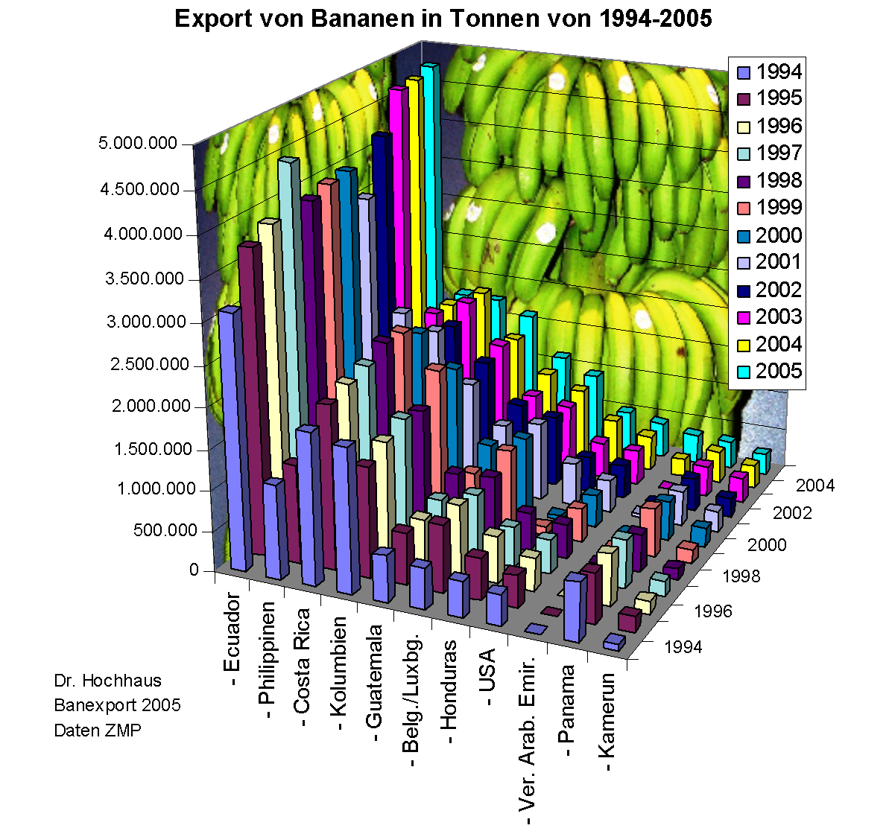
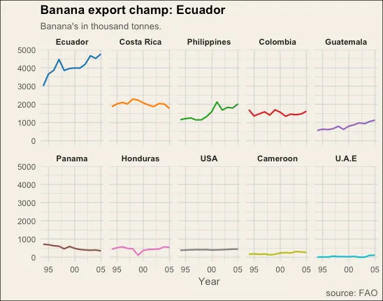
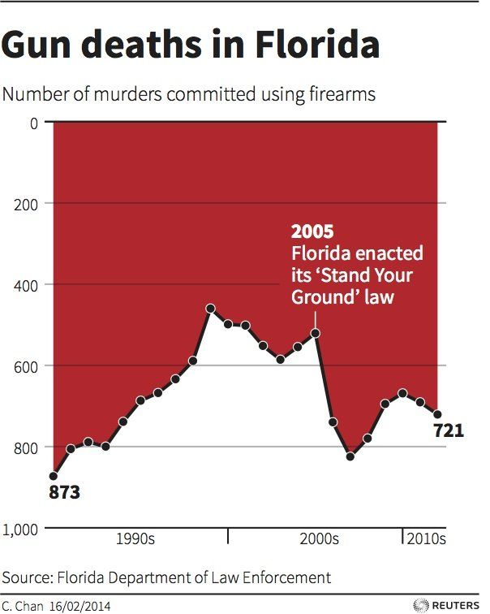
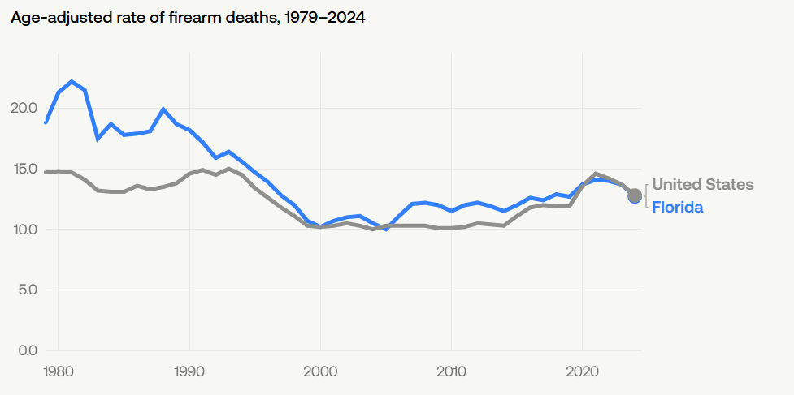
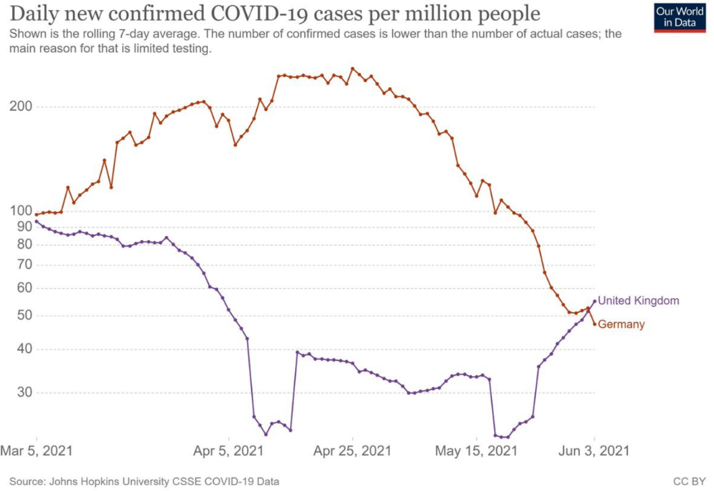
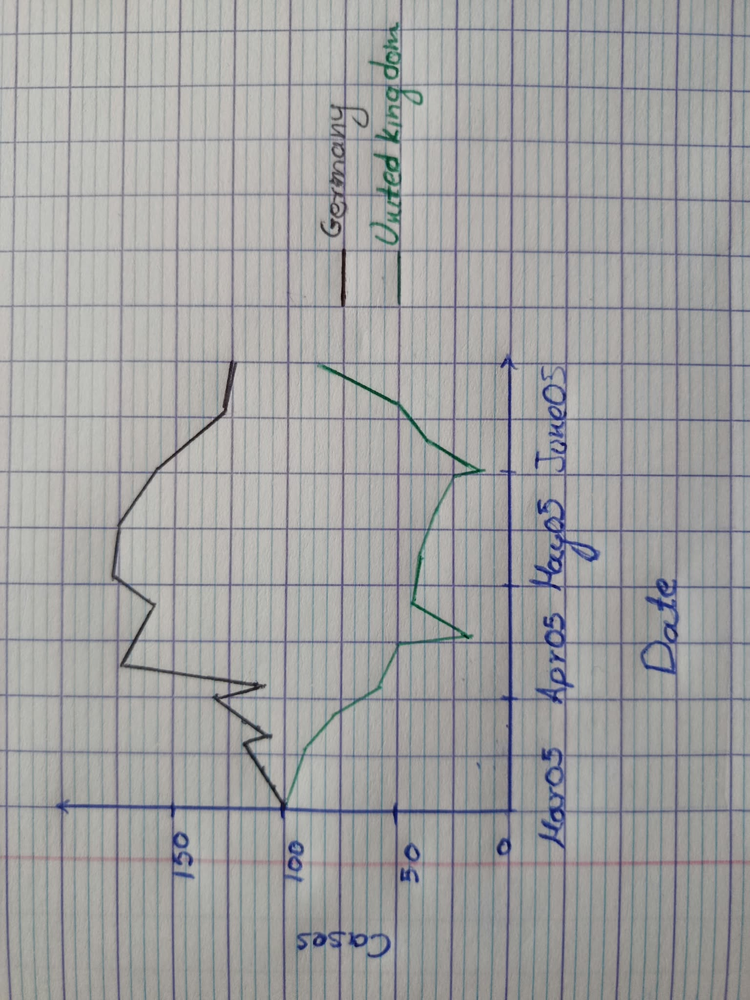

## Criticizing Figures

### Banana Export Chart

There are many things wrong with this chart.

To begin with, bars would probably not be the best choice for depicting the data. Furthermore, three different axes are not needed. The graph needs to be either split up into multiple graphs or one of the three dimensions should be removed. 3D graphs should be used only if they provide a better insight to information, since the portrayal of a 3D object on a 2D medium is by itself producing clutter, making the data less readable.

While the bars are clearly discernible from the background picture, the high contrast between the two makes the reading of this chart even more challenging.

This 3D representation makes it impossible for the observer to accurately identify which quantities the bars depict on the Y axis. This is especially true for bars that are towards the middle of the graph.

The colouring of the bars makes little sense since it essentially encodes data twice; the years are encoded both by the colours and the z-axis.

[Source](https://medium.com/tdebeus/redesign-of-a-truly-bananas-chart-1617f930808d)

This is a much better representation of the data. Here there are many graphs, one for each country, with the same X and Y axes, making it easy to compare the production of the countries, both in total and throughout the years.

### Gun Deaths In Florida

The main problem with this graph is the fact that it is trying to cause sensationalism. While this might be useful in the media, it is not when conducting any kind of research.

More specifically, conventions about the annotations (axis labels for example) are not followed, the Y axis is reverted, and the top area of the graph is filled with red colour, while the bottom area is white, something that biases the observer negatively against the information.

Another problem is that there is no baseline for the information depicted. While gun deaths might be a problem in Florida, there is no comparison with either the rest of the USA or the rest of the World.

As a result, a better representation of this graph would be the following one:

[Source](https://usafacts.org/answers/how-many-people-die-from-gun-related-injuries-in-the-us-each-month/state/florida/)

This graph presents a much clearer picture of the reality, by comparing Florida to the rest of the US, revealing that the gun death rates in Florida follow a descending trend, eventually merging with the US average in the last few years.

### Daily New COVID-19 Cases Confirmed

In my opinion, the main problem with this graph is the misleading scaling of both axes. It makes it really hard to understand the difference of the number of cases between the dates and the time between the dates that are accounted for. The difference between the depicted dates on the X axis should be equal.

Moreover, 0 is not clearly defined, which enhances the axes problem, since there is even less sense of scale.

Lastly, there is an attempt to have a grid in the graph, but it is barely discernible from the background and it does not provide actual help. An actual grid would be much more useful to the observer for reading the information in the graph.

A graph like this would provide clearer representation of the data, making the comparison between the two countries easier, by keeping the scale in both axes steady, while the grid inside the graph helps read any point in it.

